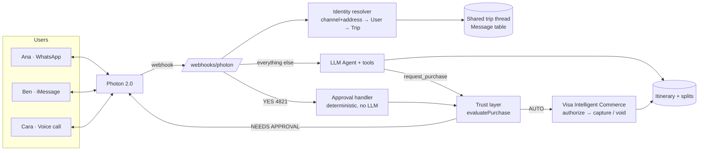

# PICA — Personal Itinerary Commerce Agent

An AI agent that plans group trips over **iMessage, SMS, WhatsApp and voice** (Photon 2.0), keeps per-person costs up to date as the plan changes, and books things through **Visa Intelligent Commerce**. It spends only within each person's own rules, and asks a person before spending anything outside them.

> ⚠️ **About the integration endpoints:** every Photon and Visa call goes through one adapter file each ([`photon.ts`](src/integrations/photon.ts), [`visa.ts`](src/integrations/visa.ts)). The paths and field names in those files are **placeholders**: map them to the real docs (search for `🔌 PHOTON` / `🔌 VISA`). Both adapters start in **mock mode**, so the whole flow runs locally without credentials.

---

## 1. Architecture

| Layer | Choice | Why |
|---|---|---|
| API / webhooks | **Node 20 + Express + TypeScript** | Easy webhook handling, one language end to end |
| Database | **SQLite + Prisma** | No setup for the hackathon; switch the provider to Postgres for prod |
| Agent | **OpenAI-compatible tool calling** (OpenAI, or Gemini through its OpenAI-compatible endpoint) | Switch models with `LLM_BASE_URL` alone |
| Communication | **Photon 2.0** | One API for iMessage, SMS, WhatsApp and Voice |
| Trust & payments | **Visa Intelligent Commerce** | Agent-scoped tokens, network-enforced controls, consent evidence |
| Dashboard | React + Vite (not in this repo yet) | Calls the REST API in [`src/routes/api.ts`](src/routes/api.ts) |



### How context survives a channel switch (Photon)
Each address a person can reach us from (a WhatsApp number, an iMessage Apple ID, the caller ID on a voice call) is stored as a `ChannelIdentity` linked to **one `User`**. Messages are stored **per Trip, not per channel**, and every line carries a `[Ana via whatsapp]` tag. When Ana calls the Photon voice number after texting on WhatsApp, her caller ID resolves to the same User and the same Trip, so the agent receives the same history. The only differences are the reply style (short and spoken for voice) and where the reply goes. See [`identity.ts`](src/identity.ts) and [`tripContext.ts`](src/agent/tripContext.ts).

iMessage, WhatsApp and SMS users can't share one native group chat. The "unified group chat" is therefore **one logical thread with a fan-out per person**. Photon delivers to each person on their preferred channel ([`notifications.ts`](src/notifications.ts)).

### How the agent is kept away from money (Visa)
1. **No card numbers.** Users enroll a card with Visa on the client side. We store only an agent-scoped token reference.
2. **Two gates.** Our [trust layer](src/commerce/trustLayer.ts) checks every share first. The same limits are pushed onto the Visa token (`syncAgentControls`), so the network declines out-of-policy charges even if our app has a bug.
3. **The LLM can't approve.** The agent has a `request_purchase` tool but no approve tool. Replies like "YES 4821" are parsed by plain code, and the **whole message** must match, so "yes sounds fun" never approves anything.
4. **Two-phase group payments.** Each share is *authorized* (held) first. If everyone is in, every hold is *captured*. If anyone declines, every hold is *voided*. Nobody pays for a half-booked hotel.
5. **Consent evidence** goes with each authorization: either the list of rule checks that passed or the id of the human approval.
6. **Safe defaults.** A user with no rules gets `autoApproveLimit = 0`, so every purchase asks first.

---

## 2. Database schema
Full schema: [`prisma/schema.prisma`](prisma/schema.prisma).

| Model | Purpose |
|---|---|
| `Trip` | The group: destination, dates, status, Photon invite link |
| `TripMember` | Membership plus preferences from the invite form: budget, likes, dislikes |
| `User` | Person, preferred channel, **Visa agent token ref** |
| `ChannelIdentity` | (channel, address) → User. Makes cross-channel context work |
| `SpendingRule` | Auto-buy limit, hard per-purchase cap, daily limit, allowed categories, blocked merchants |
| `ItineraryItem` | Day, category, merchant, total price, opt-outs, status, version |
| `ExpenseSplit` | One person's share of one item: trust-layer verdict, Visa authorization, status |
| `ApprovalRequest` | Human-in-the-loop request: code, channel, expiry |
| `Message` | Every inbound/outbound message for the trip, all channels, idempotent on Photon event id |

---

## 3. Core webhook logic
[`src/webhooks/photonWebhook.ts`](src/webhooks/photonWebhook.ts)

1. Verify the Photon HMAC signature over the raw body, then **ack 200 immediately** (the LLM is slow and Photon retries).
2. Resolve (channel, address) → User → active Trip.
3. Save the message to the trip thread. A unique `photonEventId` makes retries harmless.
4. `YES/NO + code` → deterministic approval handler. Anything else → LLM agent loop ([`agent.ts`](src/agent/agent.ts)) with tools ([`tools.ts`](src/agent/tools.ts)).
5. Reply **on the same channel**: a text, or TTS into the live call when the message came in by voice.
6. If the itinerary changed, notify the rest of the group on their own channels.

The agent can only choose options returned by `search_options` ([`catalog.ts`](src/agent/catalog.ts)), so it never makes up prices. "Make the hotel cheaper" → `search_options(LODGING, maxPrice)` → `replace_item`. "I don't want to do the beach" → `set_participation(false)`, which removes that person's share and recalculates everyone else's.

## 4. Visa rule evaluation
[`src/commerce/trustLayer.ts`](src/commerce/trustLayer.ts): `evaluatePurchase(item, policy, spendContext)` is a pure function that returns `AUTO_PURCHASE`, `REQUIRE_APPROVAL` or `DECLINE` along with every reason.

| Check | Fails → |
|---|---|
| Valid amount, Visa token linked, merchant not blocked, ≤ hard per-purchase cap | **DECLINE**: not allowed even with approval |
| Category allowed, within trip budget, within daily limit, ≤ auto-buy limit, auto-buy enabled | **REQUIRE_APPROVAL**: the person can still say yes |

The orchestration around it is in [`purchaseOrchestrator.ts`](src/commerce/purchaseOrchestrator.ts): split → evaluate everyone → abort if anyone is hard-blocked → authorize or request approval → capture all or void all.

---

## Run it

```bash
npm install
```

```bash
cp .env.example .env
```

```bash
npx prisma db push
```

```bash
npm run demo:trust
```

```bash
npm run dev
```

`demo:trust` runs the pitch scenario: a $600 hotel split four ways, checked against four different sets of rules. To try the full loop, set `OPENAI_API_KEY` (or the Gemini settings in `.env.example`), create a trip with `POST /api/trips`, join with `POST /api/invites/:code/join`, then send a fake Photon event:

```bash
curl -X POST localhost:3000/webhooks/photon -H "Content-Type: application/json" -d "{\"id\":\"evt_1\",\"type\":\"message.received\",\"data\":{\"channel\":\"whatsapp\",\"from\":\"+15551110001\",\"to\":\"+15550000000\",\"text\":\"Plan us 3 days in Lisbon, beach + food\"}}"
```

In mock mode, outbound Photon messages and Visa calls are written to the console.

## Not built yet
- React dashboard and invite/join page, plus the Visa client-side card-enrollment widget
- A sweeper job that expires stale `ApprovalRequest`s (today they expire only when someone replies)
- Passkey step-up for large approvals. SMS can be spoofed, so above a set amount send a Visa passkey link instead of accepting "YES"
- Real inventory search in place of the static catalog
